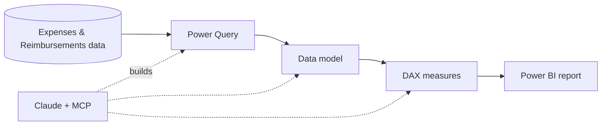

# Expense & Reimbursement Analytics

A two-page Power BI report on company expenses and reimbursements, built with **Claude through MCP**.

## Workflow



## Claude MCP
Claude connected to Power BI through MCP and:
- Wrote the DAX measures
- Updated Power Query
- Managed Model view connections

## Data model
- `public expenses`
- `public reimbursements`

## DAX
```dax
Total Expenses = SUM('public expenses'[total_amount])
```
Plus 14 more KPIs: Approval Rate %, Policy Compliance %, Missing Receipts %, Total Reimbursed, Avg Days to Reimburse, Rejection Rate %, and others.

## Report pages (https://github.com/Ramesh1414/Power-BI-projects/blob/main/expense_reimbursement_SQL.zip)
- **Expenses:** spend, approvals, compliance
- **Reimbursements:** payouts, rejections, payout speed

## Key insights
- Top 3 categories drive 47% of spend
- 22% of expenses not approved
- 86 policy breaches
- Average payout takes 8.9 days

## Setup
1. Clone the repo
2. Open the `.pbix` in Power BI Desktop
3. Update data source and refresh

## License
MIT
