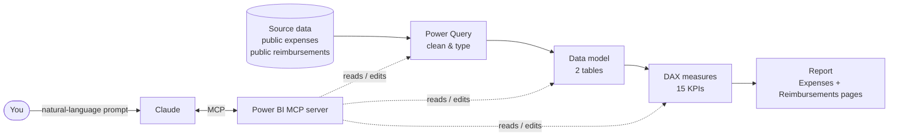

# Expense & Reimbursement Analytics (Power BI + Claude MCP)

A two-page Power BI report that tracks company expenses and the reimbursement process: spend, approval status, policy compliance, rejection reasons, and payout speed. The data model, DAX measures, and Power Query steps were built and updated with **Claude through MCP**.


---

## Workflow



1. **Import:** two tables are loaded, `public expenses` and `public reimbursements`.
2. **Power Query:** columns are cleaned and typed (dates, amounts, text).
3. **Model view:** the tables are connected so expense and reimbursement measures can be sliced by the same fields (department, approval status, payment method).
4. **DAX:** KPI measures are added for spend, compliance, approval, and payout.
5. **Report:** two pages with cards, trend lines, donuts, treemap, gauge, slicers, and a "Key Insights" panel.

---

## How Claude MCP is used in this project

**MCP (Model Context Protocol)** is an open standard that lets Claude connect to external tools. Here, an MCP server sits between Claude and the Power BI semantic model, so Claude can work on the model directly instead of only suggesting code in chat.

| What Claude did through MCP | Example prompt |
|---|---|
| **Write DAX measures** | "Create a Total Expenses measure on `public expenses`." |
| **Update Power Query** | "Change the date columns to Date type and remove null rows." |
| **Manage the Model view** | "Connect `public expenses` and `public reimbursements` on the right key." |
| **Inspect the model** | "List all tables, columns, and measures." |

**Setup (generic):**
1. Install the Power BI MCP server you are using (add its name and link here).
2. Add it to Claude's MCP config (Claude Desktop: Settings → Developer → Edit config).
3. Restart Claude and open the Power BI file or workspace.
4. Ask Claude to inspect the model first, then request changes.

> Never commit tokens, tenant IDs, or client secrets. Keep them in a local `.env` and list it in `.gitignore`.

---

## Data model

| Table | Role | Columns used in the report |
|---|---|---|
| `public expenses` | Expense transactions | `category`, `department`, `company`, `approval_status`, `payment_method`, `billable`, `client_name`, `expense_date`, `total_amount` |
| `public reimbursements` | Reimbursement transactions | `department`, `status`, `reimbursement_method`, `rejection_reason`, `reimbursement_date` |

The model also contains two auto-generated date tables (`LocalDateTable`) from Power BI's auto date/time feature, used for the **Year** slicers.

_Add the relationship(s) here after checking Model view, for example `public expenses[expense_id] → public reimbursements[expense_id]`._

---

## DAX measures

### `public expenses`

```dax
Total Expenses = SUM('public expenses'[total_amount])
```

| Measure | Purpose |
|---|---|
| `Total Expenses` | Total spend |
| `Expense Count` | Number of expenses |
| `Average Expense` | Average amount per expense |
| `Approval Rate %` | Share of expenses approved |
| `Policy Compliance %` | Share of expenses within policy |
| `Non-Compliant Count` | Number of policy breaches |
| `Missing Receipts %` | Share of expenses without a receipt |
| `Reimbursement Rate %` | Share of expenses reimbursed |

### `public reimbursements`

| Measure | Purpose |
|---|---|
| `Total Reimbursed` | Amount paid out |
| `Total Approved Amount` | Amount approved for payment |
| `Approved vs Reimbursed Gap` | Approved but not yet paid |
| `Reimbursement Count` | Number of reimbursements |
| `Rejected Count` | Number of rejections |
| `Rejection Rate %` | Share of requests rejected |
| `Avg Days to Reimburse` | Average payout time |

> Paste the full DAX for each measure into a `dax/measures.md` file. Tip: ask Claude, "Export every measure with its DAX expression."

---

## Report pages

### Page 1: Expenses
- **KPI cards:** Total Expenses, Expense Count, Average Expense, Approval Rate %, Policy Compliance %, Missing Receipts %
- **Visuals:** spend trend by date, approval-status donut, spend by category, spend by department, payment-method donut, treemap by client, non-compliant count by department
- **Slicers:** Year, department, company, category, approval status

### Page 2: Reimbursements
- **KPI cards:** Total Reimbursed, Total Approved Amount, Approved vs Reimbursed Gap, Avg Days to Reimburse, Rejection Rate %, Reimbursement Rate %
- **Visuals:** reimbursement trend, approved vs reimbursed columns, status donut, reimbursement method bars, days-to-reimburse by department, rejection reasons, gauge
- **Slicers:** Year, department, status, reimbursement method, rejection reason

---

## Key insights (from the report)

**Expenses**
- The top 3 categories (Meals, Lodging, Software) drive 47% of spend.
- 22% of expenses are not approved: 122 pending and 101 rejected.
- 86 policy breaches; 7.4% of expenses have no receipt.
- Only 35% of spend is billable; IT is the top spending department.

**Reimbursements**
- About half of rejections are avoidable (receipt issues and duplicates).
- The average payout takes 8.9 days (IT slowest at 9.5, Finance fastest at 8.4).
- Payments split evenly across Check, Direct Deposit, and Payroll (about 33% each).
- 35K is still unpaid: 122 pending expenses and a 5.5K approved-vs-paid gap.

---

## Getting started

```bash
git clone https://github.com/<username>/<repo>.git
cd <repo>
```

1. Open `reports/Expense_reimbursement.pbix` in **Power BI Desktop**.
2. Update the data source credentials under **Transform data → Data source settings**.
3. Click **Refresh**.

## Project structure

```
├── README.md
├── .gitignore
├── reports/
│   └── Expense_reimbursement.pbix
├── dax/
│   └── measures.md
├── powerquery/
│   └── queries.pq
└── docs/
    ├── expenses-page.png
    └── reimbursements-page.png
```

## Tech stack
Power BI Desktop · DAX · Power Query (M) · Claude + MCP

## License
MIT
